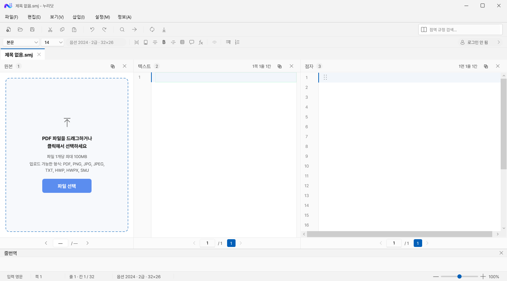
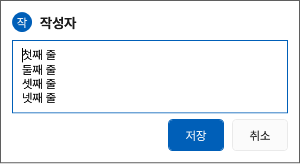
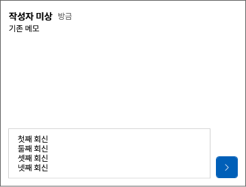
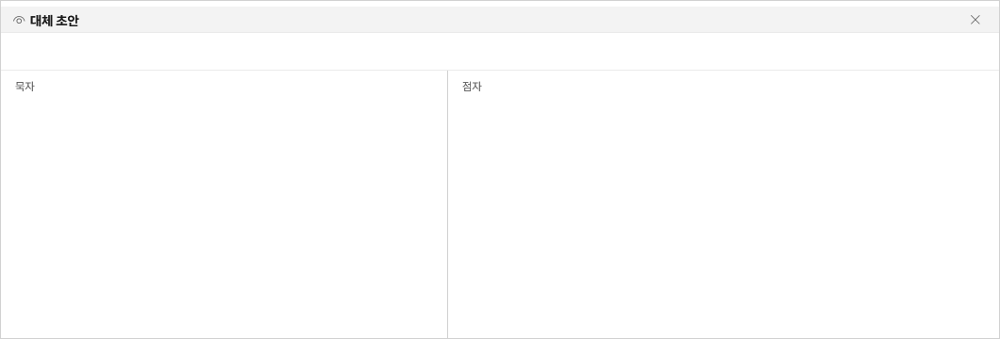
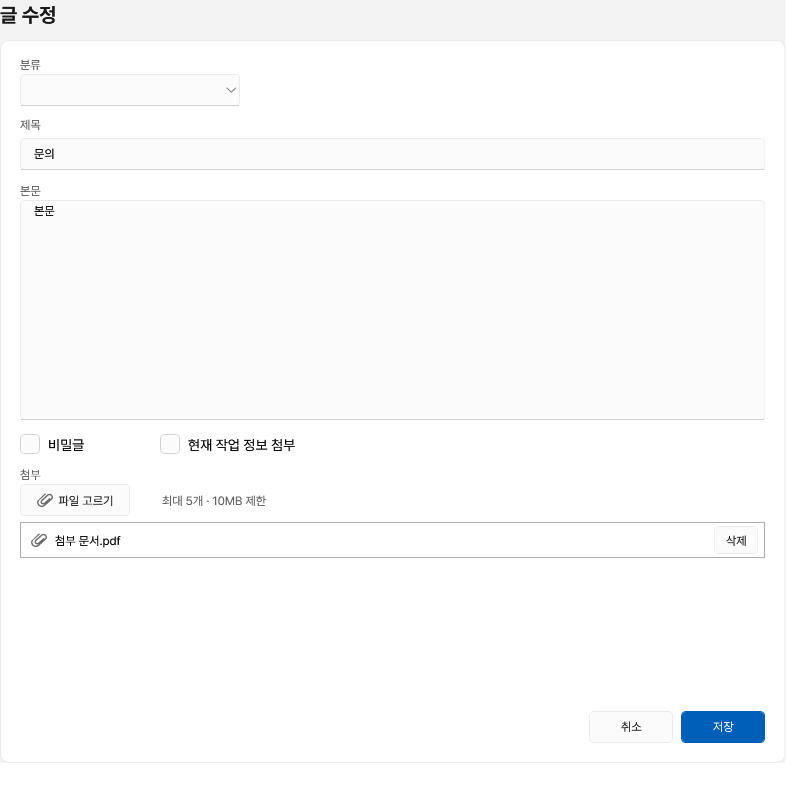

# 편집기 개선 — 2026-11-17

## 요청별 변경

| 번호 | 변경 | 검증 |
| --- | --- | --- |
| 1 | UI·원문·메모·대화상자에 Pretendard 적용. Regular/SemiBold/Bold와 OFL 라이선스 포함. IME에는 프로세스 전용 글꼴 등록, 수식의 일반 텍스트에는 번들 글꼴 파일 직접 적용. 점자·수학 기호는 전용 글리프 유지. | 세 굵기의 한글·영문·U+318D와 수식 글리프가 번들 파일에서 해석되는지 확인. 전체 화면 글꼴 회귀 검사. |
| 2 | 공백 표시 문자를 `ㆍ`(U+318D)로 변경. 원문의 실제 공백은 유지. | 표시 폭, 원문 보존, 편집·이동 검사. |
| 3 | 메모와 회신에서 Shift+Enter 줄 바꿈 시 입력창 높이 자동 확장. 최대 높이 이후 내부 스크롤. Enter 저장/전송, Ctrl+Enter 저장 유지. | 네 줄 입력 시 입력창·회신 창 확대, 마지막 줄 표시, 회신 저장 및 초기화, 메모 재열기 검사. |
| 4 | 점자 저장 형식에서 BRL 제거. BRF와 유니코드 점자 TXT 제공. | 저장 선택 목록과 실제 내보낸 파일의 확장자·내용 검사. |
| 5 | 긴 원문에 데스크톱 전용 엔진 요청 사용. 수정 시 이전 요청 취소, 최신 원문만 반영, 길이에 따른 시간 제한 적용. | 2만 자 이상 붙여넣기 후 점역 도중 추가 입력, 전체 원문·점자 보존, 최신 결과와 페이지 이동 검사. |
| 6 | 새 문서에서 원본 파일 업로드 영역 표시. | 새 문서 명령 실행 후 업로드 표시 및 탭 상태 검사. |
| 7 | 원본 업로드 영역을 패널 높이·너비에 맞게 확장. | 실제 패널/업로드 치수 비교 및 창 크기 변경 검사. |
| 8 | 시작 시 저장된 인증 정보가 만료된 경우 자격 증명을 정리하고 조용히 로그아웃 상태로 복귀. | 만료 세션 정리와 경고 없음, 네트워크 오류 및 명시적 로그인 오류의 기존 처리 검사. |
| 9 | 문의 첨부 목록에 클립 아이콘과 파일별 삭제 버튼 추가. | 기존 첨부 삭제, 새 첨부 취소, 나머지 파일 유지, 마지막 첨부 삭제 후 목록 접힘 검사. |
| 10 | AvalonEdit의 IME 글꼴 갱신 후 실제 편집기 크기·DPI에 맞게 조합 글꼴 보정. | 14/20px, 행간·굵기 변경 및 조합 메시지 이후 Win32 IME 글꼴 높이·이름 확인. |
| 11 | 마이페이지 로그아웃 아이콘과 텍스트를 수직 중앙에 정렬. | 렌더링된 아이콘·텍스트 중심 좌표 비교. |
| 12 | 사용자가 지정한 **“대체 초안” 제목 위 가로줄** 제거. 투명한 크기 조절 영역 유지. | 해당 Thumb의 배경 투명도·테두리 없음 및 초안 기능 검사. |
| 13 | 표에서 선택 셀·행·열 머리글을 기억해 도구 모음으로 이동한 뒤에도 행·열 삭제. 열 순서를 바꾸어도 바인딩 기준으로 삭제. | 셀 선택 후 행 삭제, 열 머리글 선택 후 열 삭제, 재정렬 후 삭제 및 실제 엔진 표 미리보기 검사. |

## 긴 원문 처리

서버 요소용 1,000자 제한을 원문 편집 블록에도 적용하던 경로가 실패 원인이었다. 문자를 임의로 분할하면 들여쓰기·영문 약자·짝 태그의 해석이 달라지므로, `translate_editor`는 전체 문맥을 유지해 기존 엔진 파이프라인을 호출한다. 직렬 JSONL 요청 하나 동안만 길이 제한을 조정하고 `finally`에서 복구한다. 표 구조와 수식의 기존 검증은 유지한다.

앱과 `scripts/engine-entry.py`를 포함한 엔진 번들은 함께 빌드해야 한다. 기존 엔진 바이너리만 재사용하면 새 요청을 처리할 수 없다. `scripts/publish.ps1`이 두 구성 요소를 함께 패키징한다. 엔진의 고정 커밋은 그대로이며, 다운로드 태그를 실제 존재하는 `v0.4.44`로 수정했다(패키지 버전 3.4.44).

## 재현 명령

```powershell
dotnet build Semojum.sln -c Release
dotnet run --project tests/Semojum.Core.Tests -c Release --no-build
$env:SEMOJUM_ENGINE_PYTHON = '<engine venv>/Scripts/python.exe'
& $env:SEMOJUM_ENGINE_PYTHON -m unittest discover -s tests/engine
./scripts/check-desktop.ps1 -Area qa1117,math,incremental,export,tablememo,drafts,appearance,usage -NoBuild
dotnet src/Semojum.Desktop/bin/Release/net10.0-windows10.0.19041.0/Semojum.Mockup.dll --smoke-test artifacts/smoke
```

긴 문단의 페이지별 빈 줄 배치는 기존 엔진의 별도 제한을 유지한다. 큰 표·과도하게 긴 수식의 지원 범위를 확대하는 변경은 포함하지 않는다.

## 검증 결과

Windows 로컬 Release 빌드: **경고 0, 오류 0**. 코어 검사 **121/121**, 실제 엔진 Python 검사 **13/13** 통과. 최종 커밋의 전체 WPF·Windows 패키지 검증 결과는 [PR #32](https://github.com/nuridot/Semojum/pull/32)에 기록한다.

추가로 외형 집중 검사 137개, 요청 항목 집중 검사 108개, 수식 164개, 대량 입력 8개, 내보내기 43개, 메모·표 35개, 초안 23개, 마이페이지 108개, 원본 스크롤·확대·드래그 21개를 확인했다. 이들은 전체 회귀 검사와 중복되는 검사이므로 합산하지 않는다.

깨끗한 Windows CI에서는 GDI 전용 글꼴이 WpfMath의 시스템 글꼴 검색에 나타나지 않았다. `FormulaPreview`는 번들 `FontFamily`를 직접 전달한다. WpfMath 2.1.0의 내부 텍스트 글꼴 타입에 있는 공개 생성자를 사용하는 호환 코드를 이 컨트롤 한 곳에 격리했다. 패키지 버전을 유지하며, 수식의 실제 글리프 파일을 검사해 향후 호환성 변경을 탐지한다.

자동 실행 환경에서 기존의 실제 포인터 이동, 문의 동의란 Space 키, 창 제목줄 조작, 메모 hover/실제 키보드 포커스, IME 창 비활성화 포커스 검사는 제외됐다. IME 글꼴 크기·이름 검사는 실행됐으며, 이 제외 목록과 구분한다. 실제 계정으로 문의 전송·파일 업로드 같은 서버 쓰기는 수행하지 않았다.

검사 환경: .NET SDK 10.0.100, Python 3.14, 고정된 점역 엔진 커밋 `3e7e14c2ca9f4db5c332a2b0a19835eedc78eb70`.

## 화면 확인

Windows WPF 테스트의 합성 문서·첨부 파일을 사용한 캡처다.










